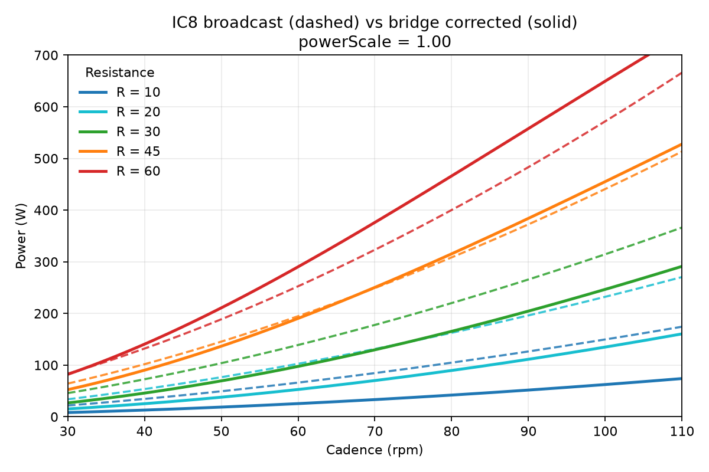
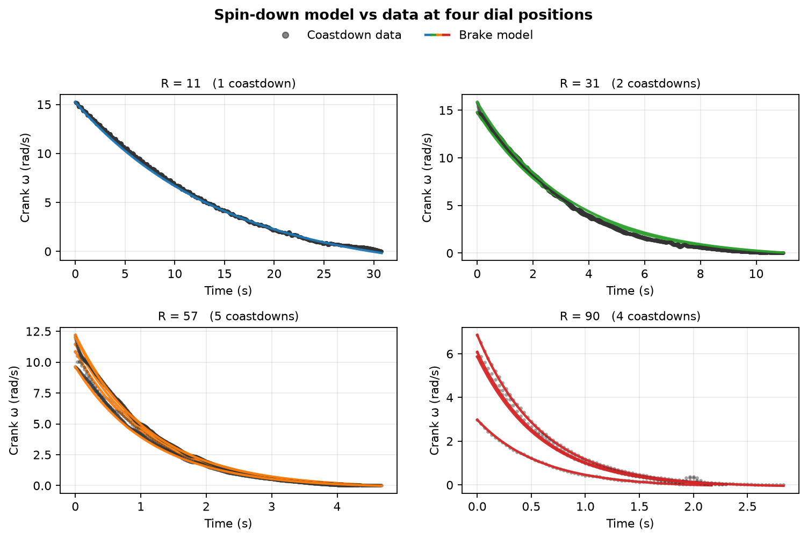
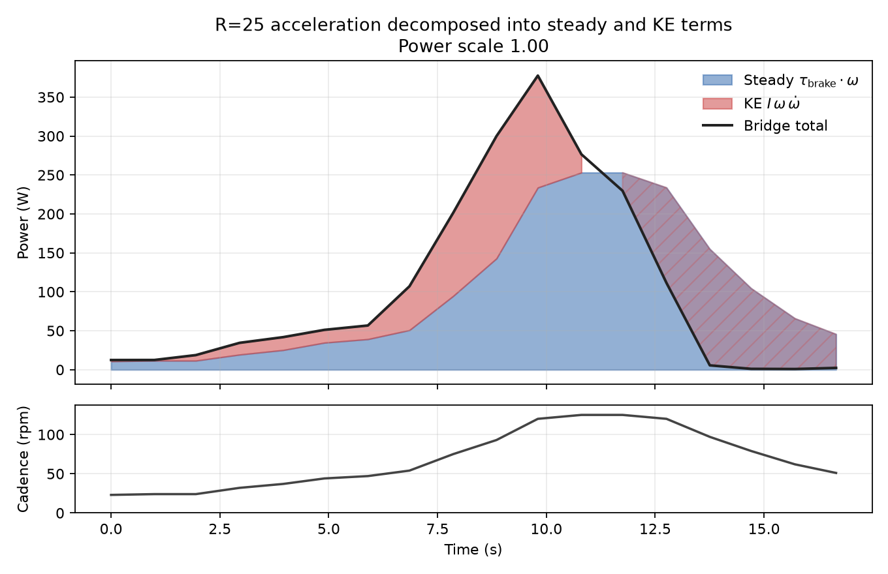

# IC Bridge

If you ride a Schwinn IC8/IC4 (or rebadged Bowflex C6/C7) and pair it
to Rouvy, MyWhoosh, Zwift, or Garmin, the broadcast power numbers can
be way off. Some riders see an exact match against a crank meter,
others see 50–100 W gaps in the same zones.
IC Bridge is a small Flutter app that reads the bike's BLE output,
applies a physics-based correction, and re-broadcasts the result as a
virtual FTMS power meter your training apps can pair to.

## What the bridge does


The bridge reads two BLE services from the bike: **FTMS Indoor Bike Data** (cadence, resistance level, the bike's own power estimate) and **CSC Cycling Speed and Cadence** (per-revolution crank counts and event times). It runs the physics correction on every sample, then advertises itself as a virtual FTMS bike + cycling power meter named **"IC Bike (corrected)"** (configurable in Settings). Your training app pairs to the bridge instead of the bike.

Heart rate works the usual way: pair your strap directly to your training app. The bridge isn't a HR proxy.

There's no resistance control. The bike has a manual dial, so ERG mode isn't possible regardless of what you pair to.

## Why use this

- **Right shape across the resistance range.** The bike's formula goes as cad^1.6 and R^0.82 (R is the resistance dial). The actual eddy-current physics is quadratic in cadence and saturates in R.
- **Honest power during transients.** Surging from 80 to 110 rpm spins up the flywheel — roughly 80–130 W the bike doesn't see. The bridge adds the kinetic-energy term `I·ω·dω/dt`, so surges read at full value and coastdowns drop to zero on time.
- **Crank-precision cadence.** The bridge reads the bike's CSC characteristic (per-revolution counts timed to 1/1024 s) on top of the noisier 1 Hz FTMS cadence field, which sharpens the acceleration math during fast transients.
- **Low-R drivetrain fine-tune.** Auto-calibrate (Settings → Auto-calibrate) refits the residual drivetrain drag from flywheel-decay curves — 5–10 minutes, on-device. It matters most at warm-up resistances; at race-pace R the eddy brake dominates. For absolute scale, use the Power scale slider against an external power meter or your FTP from one.
- **Standard FTMS out, no firmware mods.** The bridge re-broadcasts as a standard FTMS power meter, so any training app that pairs to FTMS works. The bike doesn't change.

## Supported models

The Schwinn IC8 (UK/EU), IC4 (US), and Bowflex C6/C7 are the same
underlying hardware. The defaults shipped in the app were fitted on
an IC8 and apply directly.

| Model                    | Status                                          |
|--------------------------|-------------------------------------------------|
| **Schwinn IC8 / IC4**    | Reference platform. Ships calibrated.           |
| **Bowflex C6 / C7**      | Same hardware. Ships calibrated.                |
| Other FTMS indoor bikes  | Cadence + KE math will be right, but the brake shape, magnitude, and flywheel inertia are all pinned to the IC8 family. Auto-calibrate only refits β (drivetrain drag), so a bike with different brake hardware or a different flywheel will read wrong and the in-app knobs can't fix it. |

## Build and run

```
cd bridge
flutter pub get
flutter run --release            # connect a phone via USB first; --release so the app keeps running after you unplug
```

The app starts advertising **"IC Bike (corrected)"** as soon as
Bluetooth is on; the tile under the status line says whether it is
visible and how many apps have paired. Pair your training app (on a
separate device) to it as a power meter or FTMS bike at any time,
then tap **Find bike** and pick your IC8. Keep IC Bridge in the
foreground: iOS strips the name and service list from a backgrounded
app's advertisement, and most training apps then stop seeing it.

The Darwin half of the `bluetooth_low_energy` plugin is vendored in
`bridge/packages/` with one patch: it advertises 16-bit Bluetooth SIG
UUIDs as 16-bit (upstream issue #137). Unpatched, FTMS and Cycling
Power don't fit the 31-byte advertisement and iOS moves them to the
overflow area that training apps don't scan.

If warm-up power feels off, use Settings → **Auto-calibrate**
(5–10 min, on-device). For absolute scale, do one reference session
([docs/reference-session.md](docs/reference-session.md)): a pedal
power meter grid, a mass hung from a crank arm for the inertia, or, with
no hardware, one hard indoor effort against your FTP from a road-bike
power meter. The session either sets **Power scale** or produces a
measured P(R, cadence) table that you paste into Settings → **Measured
power**, where it replaces the physics model.

## Limitations

- **Absolute scale is not anchored by a power meter on this bike.** Spin-downs measure the brake's shape in cadence and dial position, but only up to the flywheel inertia $I$: a stronger brake on a heavier flywheel slows down identically, so no analysis of spin-downs can set the scale. $I$ is a geometric estimate scaled down 17% to match heart-rate-matched outdoor rides. A threshold check puts the output about 11% high: the reference rider's 20-minute indoor climb at $R \approx 31$ reads 234 W in the model and 292 W on the bike's display, an indoor threshold of 222 W against a 200 W FTP on an outdoor power meter (`analysis/ftp_anchor.py`). Both checks go through one rider's body and hold near $R \approx 30$; elsewhere the error can vary with $R$, and the brake's ceiling comes from the manufacturer's 1000 W spec, not from data. [docs/reference-session.md](docs/reference-session.md) describes three ways to set the scale on your bike: a pedal power meter swept over $R$ 10 to 90 at three cadences, which `analysis/fit_reference.py` turns into a measured power table that replaces the model; a mass hung from a crank arm and filmed, which pins the inertia at no cost; or one hard indoor effort against your FTP from a road-bike power meter. Another unit adds its own tolerance on top.
- **High-cadence cap.** The IC8 saturates broadcast cadence at 125 rpm. Above the cap, the bridge falls back to CSC-derived cadence. Without CSC it clamps and slightly underestimates power at very high rpm.
- **Roll-off at the highest R values is theory, not data.** Our spin-downs sit mostly in the linear-damping regime where the brake is roughly linear in cadence. The saturating roll-off above that is pinned by classical eddy-brake theory (see "The fix" below) rather than fitted to our measurements.

---

## Why the bike's numbers can't be trusted

The IC8 broadcasts power as a function of cadence and the resistance
dial:

$$P_{\text{IC8}} \approx 0.0125 \cdot R^{0.82} \cdot \text{cad}^{1.6}$$

(fit to logged BLE holds, within 7% at every $R$ from 10 up). Both exponents are wrong. Real eddy-current physics gives $P \propto \omega^2$ in the linear regime, not $\text{cad}^{1.6}$, and the absolute scale drifts unit-to-unit and across the dial. That's why forum reports disagree about whether the bike reads high or low.

The shape of the gap is consistent though. Dashed lines are what the bike broadcasts, solid lines are what the bridge re-broadcasts:



The two curves cross around $R \approx 45$ at moderate cadences. Below that the bridge reads lower than the bike, above it the bridge reads higher. The exact crossover depends on your unit; the **Power scale** slider pins it against an external reference.

## The fix

The IC8 is a permanent-magnet eddy brake on an aluminum disc. Classical Wouterse / Smythe / Wiederick theory gives the brake torque as a bell curve in $\omega$, linear below the critical speed $\omega_c$ and falling above it as induced eddy currents partially cancel the source flux:

$$\tau_{\text{brake}}(R,\omega) = \tau_{\max}(R) \cdot \frac{2(\omega/\omega_c(R))}{1 + (\omega/\omega_c(R))^2}$$

Add the kinetic-energy term that matters during accelerations:

$$P_{\text{corrected}} = \tau_{\text{brake}}(R,\omega) \cdot \omega + I\,\omega\,\dot\omega$$

At steady cadence the second term is zero. During an acceleration it adds the work spent spinning up the flywheel; during a coastdown it subtracts.

### Where the constants come from

**Brake curve from spin-downs.** Strict Wouterse pins both $\tau_{\max}(R)$ and $\omega_c(R)$ to a single underlying $B^2(R)$, via $\tau_{\max} \propto B^2$ and $\omega_c \propto 1/B^2$. We parameterize $B^2(R)$ with a sum of two Hill curves:

$$H(R) = w \cdot \frac{R^{p_1}}{R^{p_1} + R_{h1}^{p_1}} + (1-w) \cdot \frac{R^{p_2}}{R^{p_2} + R_{h2}^{p_2}}, \quad \tau_{\max}(R) = \alpha\,H(R), \quad \frac{1}{\omega_c(R)} = \kappa\,H(R)$$

The two-Hill split is empirical — $B^2(R)$ has a mid-band shoulder that doesn't fit a single sigmoid, and the IC8's two magnet pairs engage across the same $R$ range, so the second Hill doesn't map cleanly to one of them.

Fit by integrating $I\,\dot\omega = -\tau_{\text{brake}} - \tau_c - I\,\beta\,\omega$ against $\omega(t)$ of every spin-down. Residual drag splits into a constant Coulomb term $\tau_c$ (bearings + belt + seal friction) and a viscous term $I\,\beta\,\omega$ (windage + air-film); $R=0$ spin-downs prefer that split over viscous-only by ~15× in RSS. $\omega(t)$ comes from 120 fps phone video (1 Hz BLE cadence is too coarse for a fast decay) across 46 segments spanning $R = 0$ to 93 (`analysis/track_crank.py`, `analysis/fit_wouterse.py`):

- $\alpha = 165$ N·m, $\beta = 0.0154$ s⁻¹, $\tau_c = 1.15$ N·m, $\kappa = 0.1585$ s/rad.
- $w = 0.599$; broad Hill $R_{h1} = 185.0$, $p_1 = 0.669$; sharp Hill $R_{h2} = 59.4$, $p_2 = 2.25$.
- $\alpha/\kappa = 1041$ W is the brake power at the critical speed $\omega_c$. At fixed $R$ the eddy power is $(\alpha/\kappa)\,2x^2/(1+x^2)$ with $x = \omega/\omega_c$, so the asymptote is $2\alpha/\kappa \approx 2080$ W. The pin was chosen as $\alpha/\kappa \approx 1000$ W; it is a prior, not a measurement, and the spin-downs never reach $\omega_c$ ($x \le 0.6$ in the data) so they cannot check it.



The H-shape, $\kappa$, and $\tau_c$ ship as fixed defaults — they entangle brake physics, the firmware's dial-to-magnet mapping, and bearing/belt friction in ways spin-down data alone can't separate. Auto-calibrate refits only $\beta$ against the linear-regime collapse $\lambda_{\text{eff}}(R) = \beta + (2\alpha\kappa/I) \cdot H(R)^2$. $\alpha$ and $I_{\text{crank}}$ are structurally degenerate in spin-down data (only their ratio appears in $I\,\dot\omega = -\tau$), so absolute scale is the Power scale slider's job, not auto-calibrate's.

**Inertia: geometric estimate, then an indirect correction.** The flywheel is a 5 mm aluminum disc ($R = 23$ cm) carrying two dense weight-rings on its faces. From ruler-measured ring dimensions and the ruler-measured belt ratio $g = 4.5$ (which enters as $g^2$), the geometric prediction is $I_{\text{crank}} \approx 9.09$ kg·m². That value takes the rings to be lead, the density at which the measured volumes add up to the 18 kg on the spec sheet. Steel rings of the same size give $I_{\text{crank}} = 6.66$ kg·m² and a 13.1 kg flywheel, cast iron 6.21. The ring heights are ruler upper bounds, and the hub, pulleys and crank are left out. A magnet on the rings settles the material, and counting flywheel turns per crank turn checks $g$.

Indoor rides at that $I$ read about 17% higher than outdoor rides on a 4iiii crank meter at the same heart rate and cadence. That comparison goes through heart rate, so it is sensitive to heat, drift, and day-to-day form, and it is not a power-meter calibration of this bike. $I_{\text{crank}}$ is the only knob that lowers absolute output without breaking the spin-down fit, so it ships at **$I_{\text{crank}} = 7.55$ kg·m²** with $\{H, \beta, \tau_c\}$ refit at that $I$ (RSS = 0.0188 across 51,792 samples). A maximal effort is a firmer check than heart rate: the rider's 20-minute indoor climb at $R \approx 31$ puts their indoor threshold 11% above their 200 W outdoor FTP at this $I$, which would mean $I_{\text{crank}} \approx 6.8$ kg·m² (`analysis/ftp_anchor.py`; $R$ is recovered from the bike's broadcast formula, which costs up to about 5% in model power). That is about 2% above the steel-ring geometry. The shipped value stays at 7.55 until the ring material is checked; a rider matching their own FTP sets Power scale instead. The FTP check covers one rider near $R \approx 30$, and the shape across the rest of the dial is the spin-downs' alone until a power meter is put on this bike. Owners of IC4/C6 units who did that report the bike's own number over-reads by 10 to 40%, growing with $R$, which is roughly where this model lands below $R \approx 50$ but not above.

Both anchors are soft. A ±30% error in $\alpha$ distorts predicted power a few percent at warm-up R, growing to roughly $-22\%$ / $+12\%$ at high R (`analysis/alpha_sensitivity.py`). The Power scale slider absorbs a uniform multiplier but not the R-shape distortion. Ground truth needs a pedal power meter on this bike, swept across R at a few cadences; the spin-down work then only has to supply the transient (kinetic-energy) term.

The in-app **Power scale** slider scales $\alpha$ and $I_{\text{crank}}$ together, so steady-state, residual drag, and the KE term move in lockstep. Default 1.0; a reference session sets it. If that session shows the ratio to a power meter changing with $R$, the shape above is wrong for the bike and the app's **Measured power** table takes over: bilinear interpolation on the measured grid, with the acceleration term kept.

## Reality check: the model decomposes an acceleration cleanly

A BLE-logged acceleration at $R = 25$: cadence climbs from 23 to 125 rpm over ~11 seconds, then the rider stops pushing and the flywheel coasts back down.



Blue area is the steady term $\tau_{\text{brake}}(R,\omega)\,\omega$, red is the KE term $I\,\omega\,\dot\omega$. KE adds ~180 W at the peak of the ramp, then flips negative during the coastdown so total power drops to near zero.

## Repository layout

```
bridge/            Flutter app (the bridge itself)
  lib/ble/           BLE central + peripheral
  lib/physics/       corrector + Wouterse coastdown fit
                     (what Auto-calibrate runs on-device) + measured
                     power table (power_table.dart)
analysis/          Calibration pipeline (Python): nRF Connect log → CSV
                   → video crank tracking → spin-down curation →
                   strict-Wouterse ODE fit. fit_reference.py compares
                   the model to a power meter and writes the table;
                   falling_mass.py gets the inertia from a hung mass;
                   ftp_anchor.py sets the scale from your FTP. Each
                   script documents its role at the top; deps in
                   `analysis/requirements.txt`.
docs/              reference-session.md (how to anchor absolute power)
docs/figures/      README plots and the bridge data-flow diagram.
```

## License

[PolyForm Noncommercial 1.0.0](LICENSE). Free to use, modify, and share for personal, research, hobby, and other noncommercial purposes. Commercial use is not permitted.
