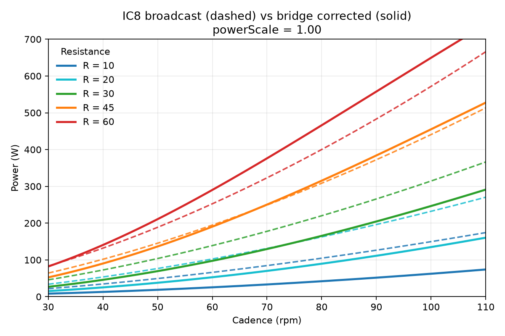
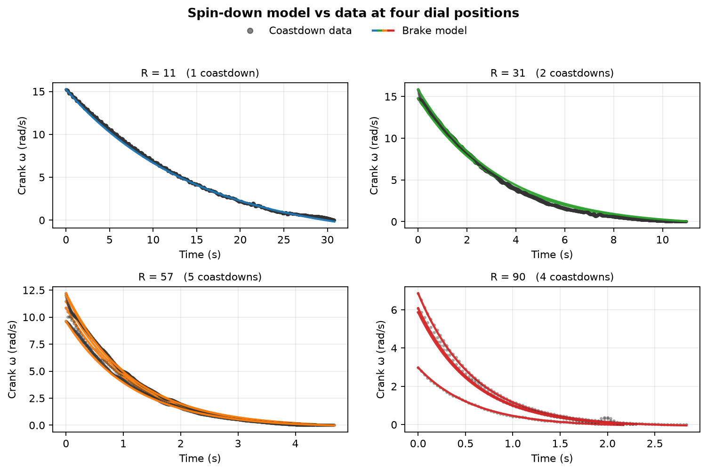
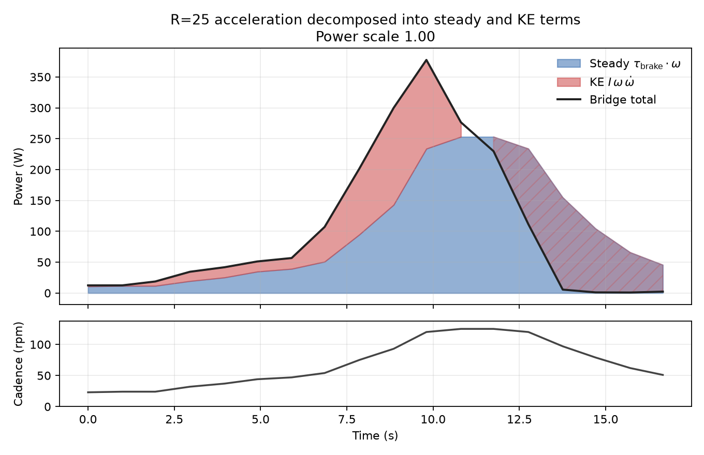

# How IC Bridge computes power

The physics behind [the README](../README.md): the bike's own formula, the model the bridge uses instead, where each constant comes from, and what has and hasn't been checked.

## The bike's own number

The IC8 broadcasts power as a function of cadence and the resistance dial $R$:

$$P_{\text{IC8}} \approx 0.0125 \cdot R^{0.82} \cdot \text{cad}^{1.6}$$

(fit to logged BLE holds, within 7% at every $R$ from 10 up; `analysis/bridge_model.py` has a closer three-term fit). Both exponents are wrong: an eddy brake's power goes as $\omega^2$, not $\text{cad}^{1.6}$, and its strength doesn't follow a power law in $R$.

Dashed lines are what the bike broadcasts, solid lines what the bridge re-broadcasts:

The two curves meet around $R \approx 50$ at 80 rpm (nearer 60 at 60 rpm, 45 at 100 rpm). Below that the bridge reads lower than the bike, by about a third at $R \approx 30$; above it the bridge reads higher, by about 12% at $R = 60$ and a third at $R = 80$, at 80 rpm. The exact crossover depends on your unit; the **Power scale** slider pins it against an external reference.

## The model

The IC8 is a permanent-magnet eddy brake: two pairs of N42 magnets straddle a 5 mm aluminium disc at a fixed 3 mm gap, and the dial slides them from just off the rim onto the disc. A magnet moving through a conducting sheet induces currents that drag on it in proportion to speed, so at the crank the brake is linear damping:

$$\tau_{\text{brake}}(R,\omega) = c\,H(R)^2\,\omega$$

where $c\,H(R)^2$ is the brake's damping at dial position $R$. It grows as the dial slides the magnets onto the disc, to 12.8 N·m·s/rad at $R = 100$. The bike's power is that torque plus the residual drag of the drivetrain, plus the kinetic-energy term that matters during accelerations:

$$P_{\text{corrected}} = \left(c\,H(R)^2\,\omega + \tau_c + I\,\beta\,\omega\right)\omega + I\,\omega\,\dot\omega$$

At steady cadence the last term is zero. During an acceleration it adds the work spent spinning up the flywheel; during a coastdown it subtracts.

## Where the constants come from

### Brake curve from spin-downs

$H(R)$ is a sum of two Hill curves:

$$H(R) = w \cdot \frac{R^{p_1}}{R^{p_1} + R_{h1}^{p_1}} + (1-w) \cdot \frac{R^{p_2}}{R^{p_2} + R_{h2}^{p_2}}$$

The two-Hill split is empirical: the curve has a mid-band shoulder that doesn't fit a single sigmoid, and the IC8's two magnet pairs engage across the same $R$ range, so the second Hill doesn't map cleanly to one of them. $H$ runs from 0 at $R = 0$ to 0.54 at $R = 100$ and would reach 1 only far past the dial's end, so $c$ is the fit's scale, not the full-dial damping.

Fit by integrating $I\,\dot\omega = -\tau_{\text{brake}} - \tau_c - I\,\beta\,\omega$ against $\omega(t)$ of every spin-down. Residual drag splits into a constant Coulomb term $\tau_c$ (bearings + belt + seal friction) and a viscous term $I\,\beta\,\omega$ (windage + air-film); $R=0$ spin-downs prefer that split over viscous-only by ~15× in RSS. $\omega(t)$ comes from 120 fps phone video (1 Hz BLE cadence is too coarse for a fast decay) across 46 segments spanning $R = 0$ to 93 (`analysis/track_crank.py`, `analysis/fit_spindowns.py`):

- $c = 43.77$ N·m·s/rad, $\beta = 0.0139$ s⁻¹, $\tau_c = 1.10$ N·m, at $I_{\text{crank}} = 6.66$ kg·m² (see Inertia below).
- $w = 0.450$; broad Hill $R_{h1} = 129.3$, $p_1 = 0.650$; sharp Hill $R_{h2} = 78.9$, $p_2 = 1.87$. At $R = 100$, $c\,H^2 = 12.8$ N·m·s/rad.
- RSS 0.0119 across 51,792 samples.

### No fade in the data

Textbook eddy brakes fade at high speed, where the induced currents' own field cancels the magnets' (Wouterse, IEE Proc. B 138, 153, 1991). Earlier versions modelled that with a fade speed that dropped as the dial moved the magnets on, the way it does when a brake's gap closes, pinned by the spec sheet's 1000 W. The IC8's gap is fixed, and the spin-downs reject that model: with its fade speed free, the fit drives it to infinity, and the shipped fit is 37% better in RSS than the old one. A fade at a fixed crank speed fits worse the lower it sits: 4% worse in RSS at 300 rpm, 40% at 160 rpm, 98% at 120 rpm (`analysis/fit_spindowns.py --fade-profile`). Thin-sheet theory puts it at 90 to 125 rpm for a pure-aluminium or 6061 disc (`analysis/physics_first_brake.py`), which the data rule out; the disc's alloy is unknown, and a less conductive one would move the fade up.

### Magnet physics cross-check

`analysis/physics_first_brake.py` solves the low-speed eddy currents (Wiederick et al., Am. J. Phys. 55, 500, 1987) for the measured magnets, gap and disc, with the field from the magnetic circuit and conductivity for pure aluminium or 6061. At $R = 100$ it gives 1.0 to 2.5 times the fitted damping at the shipped inertia; the field is an upper bound (leakage is ignored), so the low end is likelier. With the dial taken as linear in magnet travel, the geometry's shape matches the fit within 8% from $R = 50$ up and runs lower below: at $R = 30$ the fit has 14% of the full-dial damping and the geometry 10%. The dial-to-magnet mapping is the likely difference. Refitting with the geometry's shape and a one-parameter warp of the dial in place of the two Hills fits 2.5 times worse in RSS (`analysis/fit_geom_hill.py`), so the two-Hill form ships.

### What Auto-calibrate fits

The H-shape and $\tau_c$ ship as fixed defaults; they entangle brake physics, the dial-to-magnet mapping, and bearing/belt friction in ways spin-down data alone can't separate. Auto-calibrate refits only $\beta$, against the collapse $\lambda_{\text{eff}}(R) = \beta + (c/I) \cdot H(R)^2$ of each spin-down's decay rate. $c$ and $I_{\text{crank}}$ are structurally degenerate in spin-down data (only their ratio appears in $I\,\dot\omega = -\tau$), so absolute scale comes from the inertia below and the Power scale slider, not from auto-calibrate.

### Inertia

The flywheel is a 5 mm aluminium disc ($R = 23$ cm) with a steel weight ring on each face, ruler-measured at $r$ = 14 to 18 cm by 2.03 cm and 13 to 17 cm by 1.52 cm. A magnet sticks to the rings and not to the disc. That is a 13.1 kg flywheel, and with the belt ratio $g = 4.5$ (which enters as $g^2$) it gives **$I_{\text{crank}} = 6.66$ kg·m²**, the shipped value. Spin-downs fix only torque over inertia, so $c$ and $\tau_c$ ship as the fit carried to this $I$: scaling $c$, $\tau_c$ and $I$ together leaves every fitted $\omega(t)$ and the RSS unchanged. The ring heights are ruler upper bounds with chamfered edges, the hub, pulleys and crank are left out, and $g$ is a ruler measurement; counting flywheel turns per crank turn would pin it. A magnet does not tell steel from cast iron, which would give 6.21. So the geometry holds to roughly 10%. Earlier versions shipped 9.09, which took the rings to be lead because only lead brings the measured volumes up to the spec sheet's 18 kg, and then 7.55, from matching outdoor rides at equal heart rate.

### Checks against a rider's FTP and owner reports

A maximal effort cross-checks the geometry through one rider: their best 20 minutes indoors at $R \approx 31$ read 207 W in the model (292 W on the bike's display), an indoor threshold of 197 W against their 200 W outdoor FTP on a 4iiii crank meter, 2% apart (`analysis/ftp_anchor.py`; $R$ is recovered from the bike's broadcast formula, which costs up to about 5% in model power). That check covers $R \approx 30$, and the shape across the rest of the dial is the spin-downs' alone until a power meter is put on this bike. Owners of IC4/C6 units who did that report the bike's own number over-reads by 10 to 40%, growing with $R$. This model puts the over-read at about 55% near $R = 30$ and 20% at $R = 40$, and has the bike under-reading from $R \approx 50$ up, by about a quarter at $R = 80$ (all at 80 rpm): it matches those reports mid-dial but runs against their growth with $R$. The spin-downs measure the brake directly up to $R = 93$, so a pedal power meter on this bike is what would settle it.

### Power scale and measured power

The in-app **Power scale** slider scales $c$, $\tau_c$ and $I_{\text{crank}}$ together, so steady-state, residual drag, and the KE term move in lockstep. Default 1.0; a [reference session](reference-session.md) sets it. If that session shows the ratio to a power meter changing with $R$, the shape above is wrong for the bike and the app's **Measured power** table takes over: bilinear interpolation on the measured grid, with the acceleration term kept.

## An acceleration, decomposed

A BLE-logged acceleration at $R = 25$: cadence climbs from 23 to 125 rpm over ~11 seconds, then the rider stops pushing and the flywheel coasts back down.

Blue area is the steady term $\tau_{\text{brake}}(R,\omega)\,\omega$, red is the KE term $I\,\omega\,\dot\omega$. KE adds ~160 W at the peak of the ramp, then flips negative during the coastdown so total power drops to near zero.

## Where the model is extrapolated

Spin-downs at $R \le 57$ start at 116 to 165 rpm, but above that they start lower: the fastest at about 100 rpm for $R$ 66 to 74, and at 57 to 91 rpm for $R$ 81 to 93. Riding $R \ge 80$ above about 90 rpm, or $R \approx 70$ above about 100 rpm, carries the linear brake past the data. The spin-downs fit worse with a fade anywhere below about 250 rpm at the crank (see "No fade in the data"), but they cannot rule one out in that corner.

The IC8 caps its FTMS cadence at 125 rpm. The bridge takes cadence from the bike's CSC crank counts whenever they arrive, so the cap only matters without them; then it holds cadence at 124 rpm and reads low above it.
